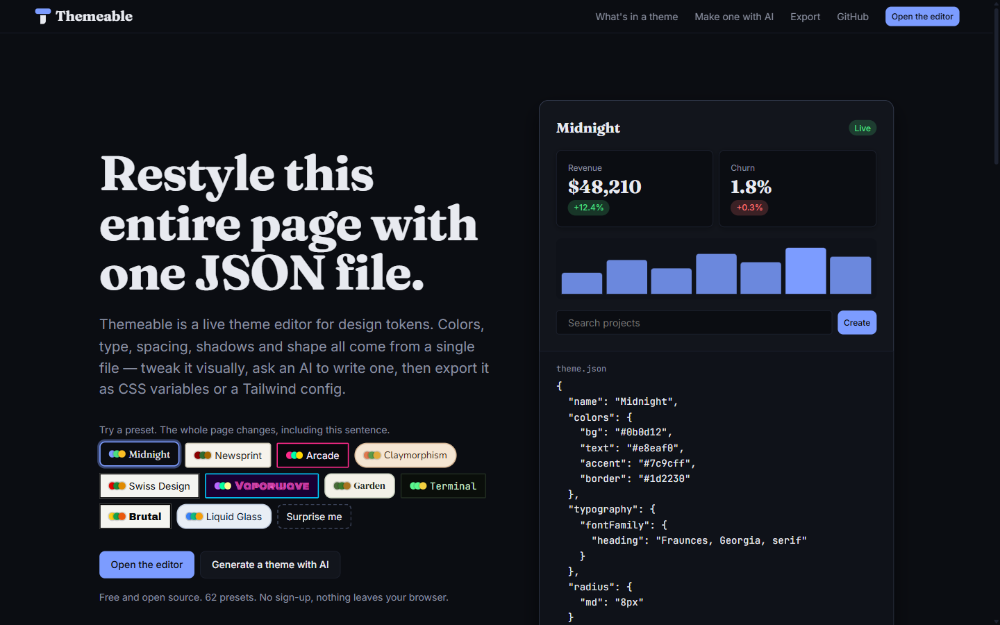
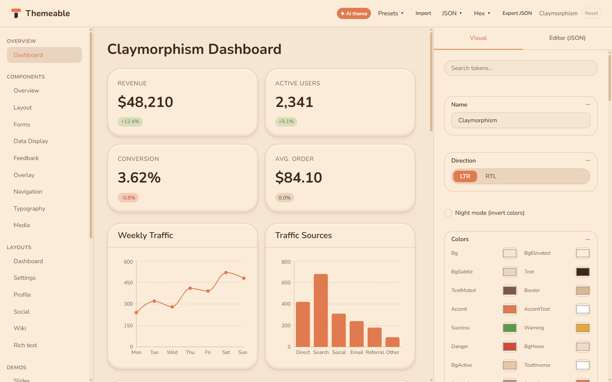

<p align="center">
  <picture>
    <source media="(prefers-color-scheme: dark)" srcset="docs/brand/themeable-horizontal-on-dark.svg" />
    
  </picture>
</p>

# Themeable

**One JSON file restyles an entire UI.** Themeable is a live theme editor for design tokens: pick one of 62 presets, tweak colors, type, spacing, shadows and shape visually or as JSON, have an AI write a theme for you, and export the result as CSS variables or a Tailwind config.



## Features

- **62 hand-made presets.** Midnight, Newsprint, Arcade, Claymorphism, Swiss Design, Vaporwave, Liquid Glass and more. Each one changes type, shape and shadows, not only colors.
- **Visual and JSON editing.** Color pickers, length inputs with unit switching, shadow builders and a font picker, or edit the raw JSON with live validation.
- **Generate themes with AI.** Describe a look, copy a ready-made prompt into ChatGPT, Claude, Gemini or any chat AI, then paste the reply back. The prompt includes the full schema, contrast rules and the fonts the app can load.
- **Real fonts.** Themes that reference Google Fonts (Inter, Fraunces, VT323, Space Grotesk and about 50 others) load them on demand.
- **Import and export.** JSON, plain CSS `:root` variables, a Tailwind v4 `@theme` block or a Tailwind v3 config, with colors in hex, RGB, HSL or OKLCH. Imports detect the format automatically.
- **A full UI to test against.** Dashboard, component gallery (forms, data display, feedback, overlays, navigation, typography, media), page layouts, charts and demo apps (chat, kanban, slides, finance, notes and more), all driven by the same tokens.
- **RTL and responsive.** Flip `direction` to `rtl` and the whole layout mirrors. The shell adapts from phone to wide desktop.
- **Private by default.** Everything runs in the browser and auto-saves to `localStorage`. No account, no backend.



## Quick start

```bash
npm install
npm run dev        # http://localhost:5173
```

| Script | What it does |
| --- | --- |
| `npm run dev` | Start the Vite dev server |
| `npm run build` | Type-check and build to `dist/` |
| `npm run preview` | Serve the production build |
| `npm test` | Run the Vitest suite |

## Make a theme with AI

1. Open the app and click **✦ AI theme** (or use the "Make one with AI" section on the landing page).
2. Describe the look you want and click **Copy AI prompt**.
3. Paste it into any chat AI. It replies with a theme JSON.
4. Paste the whole reply into step 2 of the dialog and click **Apply theme**. Code fences and surrounding text are stripped automatically.

Using [Claude Code](https://claude.com/claude-code)? This repo ships a `Themeable` skill in [.claude/skills/Themeable](.claude/skills/Themeable/SKILL.md). Ask for "a theme that feels like a 1970s NASA control room" and it writes `themes/<name>.json` for you to import.

## Theme format

A theme is a single JSON object. The full TypeScript type lives in [src/theme/schema.ts](src/theme/schema.ts) and is validated by [src/theme/validate.ts](src/theme/validate.ts).

| Key | Contents |
| --- | --- |
| `name` | Display name |
| `colors` | 20 slots: `bg`, `bgElevated`, `bgSubtle`, `bgHover`, `bgActive`, `text`, `textMuted`, `textInverse`, `border`, `borderStrong`, `accent`, `accentText`, `success`, `warning`, `danger`, `info`, `link`, `focusRing`, `codeBg`, `overlay` |
| `typography` | `fontFamily` (`body`, `heading`, `mono`), `fontSize` (`xs`–`2xl`), `fontWeight`, `lineHeight` |
| `spacing` | `unit`, `xs`–`2xl` |
| `radius` | `none`, `sm`, `md`, `lg`, `full` |
| `shadows` | `none`, `sm`, `md`, `lg`, `button`, `input`, `card`, `focus`, `inner`, `glow` |
| `borders` | `width`, `style` (`solid` / `dashed` / `dotted` / `none`) |
| `transitions` | `fast`, `normal`, `slow` |
| `breakpoints` | `sm`, `md`, `lg`, `xl`, `2xl` |
| `direction` | `ltr` or `rtl` |
| `nightMode` | `true` inverts the whole page with a CSS filter, a quick way to preview a light theme dark |
| `customCss` | Raw CSS appended after the generated `:root` block |

Every token becomes a CSS custom property (`--color-accent`, `--font-heading`, `--radius-md`, `--shadow-card`, …) that components read directly.

## Project structure

```
src/
  theme/        schema, validator, CSS engine, presets, font loader, AI prompt, io/ (import & export)
  state/        useTheme (state + auto-save) and ThemeProvider (single shared instance)
  components/
    ai/         AI prompt builder and dialog
    editor/     visual editor, JSON/code editor, import/export controls
    dashboard/  app shell (nav, sidebar) and dashboard widgets
    ui/         primitives: Button, Menu, Modal, Drawer, ColorInput, FontPicker, ...
  pages/        landing page, dashboard, component gallery, layouts, charts, demos
  styles/       base, component and landing styles, all token-driven
tests/          Vitest suites for the theme engine, io, state and UI primitives
```

## Deploying

It's a static single-page app. `npm run build` produces `dist/`, which you can deploy anywhere. SPA fallbacks are included for Vercel ([vercel.json](vercel.json)) and Netlify ([public/_redirects](public/_redirects)). After deploying, set `og:image` in [index.html](index.html) to an absolute URL so link previews show the card image, and add your repo link in [src/siteConfig.ts](src/siteConfig.ts).

## Contributing

Issues and pull requests are welcome, and new presets especially. A preset is a `Theme` object in [src/theme/presets.generated.ts](src/theme/presets.generated.ts). Add it to the `presets` array, and `npm test` checks that it validates and that its name is unique.

## Brand

The Token T logo, colours and usage rules are in [brand/logo](brand/logo/README.md).

## License

[MIT](LICENSE)
