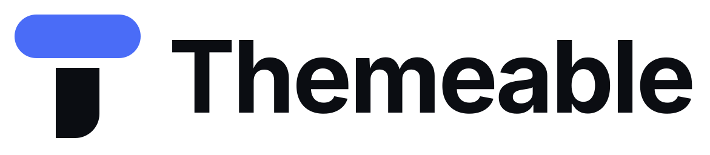

# Themeable logo

**Token T**: a T assembled from two design tokens, a pill-shaped swatch resting on a square stem. One letter, two radius tokens (fully round and square). The pill carries the accent colour, so the logo can be themed like everything else in the app.

| Light backgrounds | Dark backgrounds |
| --- | --- |
|  |  |

## Files (`kit/`)

| Use | File |
| --- | --- |
| Horizontal lockup (default) | `themeable-horizontal.svg`, `themeable-horizontal-on-dark.svg` |
| Stacked lockup (square spaces) | `themeable-stacked.svg`, `themeable-stacked-on-dark.svg` |
| Symbol only | `themeable-symbol.svg`, `themeable-symbol-on-dark.svg` |
| Symbol below 32 px | `themeable-symbol-small.svg`, `themeable-symbol-small-on-dark.svg` |
| Wordmark only | `themeable-wordmark.svg`, `themeable-wordmark-on-dark.svg` |
| One colour | `themeable-symbol-black.svg`, `-white.svg`, `-mono-4a6cf7.svg` |
| App icon / avatar | `themeable-symbol-app-icon.svg`, `icon-192.png`, `icon-512.png`, `maskable-512.png`, `apple-touch-icon.png` |
| Browser | `favicon.svg` (adapts to dark tabs), `favicon.ico`, `favicon-16/32/48.png`, `site.webmanifest`, `head-snippet.html` |
| Presentation | `presentation.html`, `board/slide-*.png` |

All marks are outlines only: no live text, no gradients, no effects.

## Colour

| Name | Hex | RGB | Use |
| --- | --- | --- | --- |
| Token Blue | `#4a6cf7` | 74 108 247 | Pill on light backgrounds; primary brand colour (4.4:1 on white and on Ink) |
| Token Blue Light | `#7c9cff` | 124 156 255 | Pill on dark backgrounds (the Midnight accent) |
| Ink | `#0b0d12` | 11 13 18 | Stem and wordmark on light; app-icon tile |
| Snow | `#e8eaf0` | 232 234 240 | Stem and wordmark on dark |
| Paper | `#f6f7fb` | 246 247 251 | Light background |

Inside the app, the logo uses the active theme: pill = `--color-accent`, stem = `--color-text`. Outside the app, use the fixed colours above.

## Clear space and minimum size

- Keep clear space equal to the pill height (72 units on the 256 grid, about 28 % of the symbol height) on every side.
- Horizontal lockup: minimum 96 px wide on screen, 25 mm in print.
- Symbol: minimum 16 px. Below 32 px, use the `-small` cut (wider gap, heavier parts).

## Construction

8-unit grid on a 256 canvas. Pill: 208 × 72, radius 36. Stem: 72 × 116, bottom-right radius 40. Gap between them: 16 (24 in the small cut). The symbol sits 4 units above geometric centre (optical centring).

Wordmark: Inter Bold (SIL Open Font License), tracking −2.5 %, converted to outlines. Cap height is 120 against the 204-unit symbol.

Rebuild everything with `python build_kit.py` (it needs Inter Bold as `inter-700.ttf` next to the script, which is not committed).

## Don't

- Recolour the stem with the accent, or the pill with the text colour; the two-token contrast is the idea.
- Rotate, stretch, outline, add shadows or gradients.
- Close the gap between pill and stem, or round the stem's top corners.
- Set "Themeable" in another typeface next to the symbol; use the lockup files.
- Place the light-background version on dark backgrounds; use the `-on-dark` files.

## Notes

- `concepts/` holds the exploration round (A Radius scale, B Folded file, C Token T).
- No trademark search has been done. Run one (e.g. EUIPO, USPTO, WIPO Global Brand Database) before registering the name or mark.
